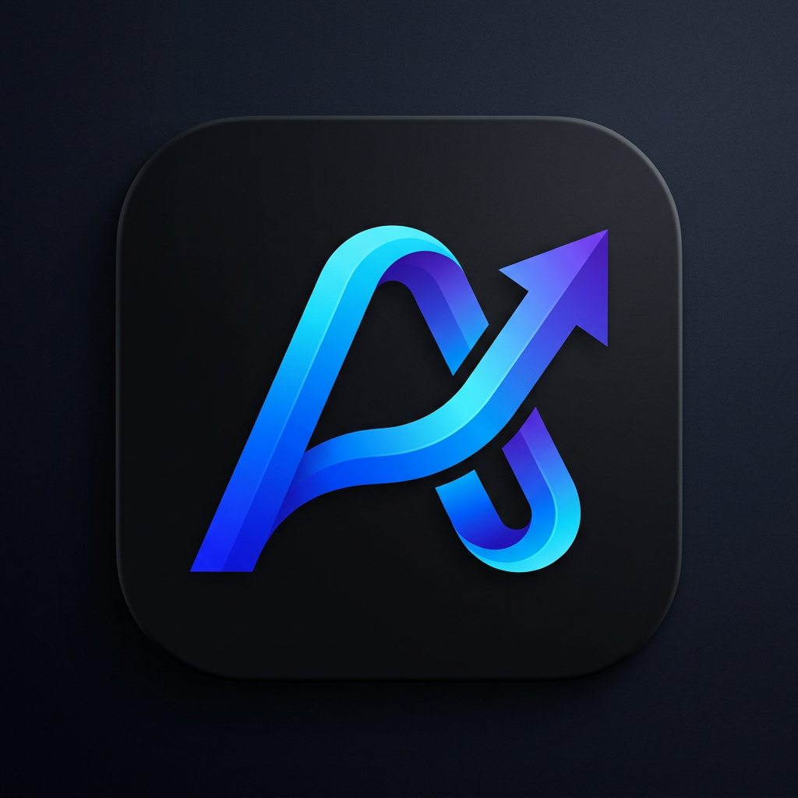

# AccountGo

<p align="center">
  
</p>

<p align="center">
  <strong>Modern, Cloud-Native, Multi-Tenant Accounting & ERP Platform</strong>
</p>

<p align="center">
  <a href="https://github.com/AccountGo/accountgo/actions/workflows/ci.yml"></a>
  
  
  
  
  
  
  <a href="LICENSE"></a>
  <a href="https://buymeacoffee.com/marvinperez"></a>
</p>

---

## Live Deployments

- **Web Application (SPA)**: [https://app.accountgo.dev](https://app.accountgo.dev)
- **Backend API & Containers**: [https://api.accountgo.dev](https://api.accountgo.dev)

---

## Overview

**AccountGo™** is an open-source, enterprise-grade accounting and ERP suite designed for small to medium enterprises, multi-company groups, and non-profit organizations.

Re-architected for modern cloud infrastructure, AccountGo combines a high-performance **.NET 10** backend containerized on Cloudflare edge compute with a responsive **React 19** single-page application powered by **Vite** and **Tailwind CSS v4**.

---

## Quick Start with a Coding Agent

Paste this prompt into **Gemini, Claude, Codex**, or your preferred coding agent to clone, configure (SQLite by default), build, and run AccountGo locally:

```text
Set up AccountGo for local development:
1. If not already inside an AccountGo checkout (`src/Api/Api.csproj` and `src/Web/package.json`), clone `https://github.com/AccountGo/accountgo.git` and `cd accountgo`.
2. Read and follow `.agents/skills/accountgo-local-dev/SKILL.md` (and `docs/readme/local-development.md` if needed) to verify prerequisites, install dependencies, build the API and Web app, configure `src/Api/.env` with local SQLite if missing, and start both the API (`http://localhost:8001`) and Web UI (`http://127.0.0.1:3000`).
3. Verify `http://localhost:8001/health` is healthy and `http://127.0.0.1:3000/` returns HTTP 200, then report the running URLs and any errors.
```

Prefer manual setup? Follow [Run Locally: API, Web & DB](docs/readme/local-development.md).

---

## Quick Navigation

| Section | Description |
| :--- | :--- |
| 🖼️ [User Interface Showcase](docs/readme/showcase.md) | Screenshots of login, workspace selector, dashboard, ledger, RBAC, and mobile PWA. |
| ✨ [Core Capabilities & Features](docs/readme/features.md) | Multi-tenancy, auth, GL, AR/AP, inventory, donations, and audit trails. |
| 🏗️ [Architecture & Tech Stack](docs/readme/architecture.md) | Edge architecture diagram, technology stack, and repository structure. |
| 💻 [Run Locally: API, Web & DB](docs/readme/local-development.md) | Prerequisites, `.env` setup, SQLite/PostgreSQL, local dev servers, and tests. |
| 🚀 [Deployment to Cloudflare](docs/readme/deployment.md) | AccountGo Cloud vs. self-hosting on Cloudflare Workers & Containers. |

---

## Documentation

Comprehensive architecture, development, and operational guides are available in [`docs/`](docs/):

- 🏛️ [System Architecture](docs/ARCHITECTURE.md) — Multi-tenant domain model, Clean Architecture, and Cloudflare edge design.
- 💻 [Development Guide](docs/DEVELOPMENT.md) — Local workstation setup, running services, debugging, and testing.
- 🚀 [Deployment Guide](docs/DEPLOYMENT.md) — Self-host on Cloudflare Workers and Containers.
- 🔒 [Security](docs/SECURITY.md) — Disclosure and hosting posture.
- 📒 [Chart of Accounts & Posting Rules](docs/accounting/coa-register.md) — COA register, posting rules, and GAAP/IFRS controls.
- 📒 [COA Import, Export & Lifecycle](docs/accounting/coa-import-export-requirements.md) — Structure CSV, archive rules, Append/Upsert/Replace modes.
- 🧾 [General Ledger Redesign](docs/accounting/general-ledger-redesign.md) — Financials page as posted journal register (implementation brief).
- 🧪 [Double-Entry Accounting Tests](docs/accounting/double-entry-tests.md) — 7 Accuracy Guarantees and automated ledger verification suite.
- 📋 [Changelog](docs/CHANGELOG.md) — Version history and release notes.
- 🏷️ [Releasing](docs/RELEASING.md) — How changes are recorded and releases are cut.

---

## Support AccountGo

AccountGo's open-source core is built and maintained by one person. If it's useful to you, these all help:

- ⭐ **Star the repository** so more people find it.
- 🐛 **Report bugs and suggest features** on [GitHub Issues](https://github.com/AccountGo/accountgo/issues).
- 🛠️ **Contribute** code, docs, or translations (see [Contributing](#contributing)).
- ☁️ **Use [AccountGo Cloud](https://accountgo.dev/pricing/)** if you'd rather not self-host. Paid plans fund development directly.
- ☕ **[Buy me a coffee](https://buymeacoffee.com/marvinperez)** if you'd like to say thanks.

A coffee is a personal thank-you to the maintainer. It isn't a tax-deductible donation, and it doesn't buy features, priority support, roadmap influence, or any licence or trademark rights. For support or commercial terms, email [support@accountgo.dev](mailto:support@accountgo.dev).

---

## Contributing

Contributions, issues, and feature requests are welcome! We appreciate help making AccountGo the leading open-source accounting platform.

- 📖 **Contribution Guidelines**: Please review our [Contributing Guide](CONTRIBUTING.md) for branch naming, coding standards, and testing expectations.
- 🤝 **Code of Conduct**: All participants are expected to adhere to our [Code of Conduct](CODE_OF_CONDUCT.md).
- 🔒 **Security Disclosures**: Found a vulnerability? Please follow our [Security Policy](SECURITY.md) instead of filing a public issue.
- 🐛 **Issue Tracker**: Report bugs and propose features on the [GitHub Issues](https://github.com/AccountGo/accountgo/issues) page using our templates.

---

## Author & Maintainer

**AccountGo** was created and is actively maintained by **Marvin Perez**.

- ✉️ **Email**: [support@accountgo.dev](mailto:support@accountgo.dev)
- 🌐 **GitHub**: [@mvperez](https://github.com/mvperez) / [AccountGo](https://github.com/AccountGo)

---

## License

This project is licensed under the **GNU Affero General Public License v3.0 only (AGPL-3.0-only)**. See the [LICENSE](LICENSE) file for the full license text and [NOTICE](NOTICE) for copyright and license history.

If you modify AccountGo and let users interact with it over a network, the AGPL requires you to offer those users the corresponding source code of your modified version.

### Trademarks

"AccountGo", "AccountGo Cloud", and the AccountGo logos are trademarks of Marvin Perez and are **not** covered by the AGPL. Forks and third-party hosted services must use a different name and remove the AccountGo logos. See [TRADEMARKS.md](TRADEMARKS.md).
