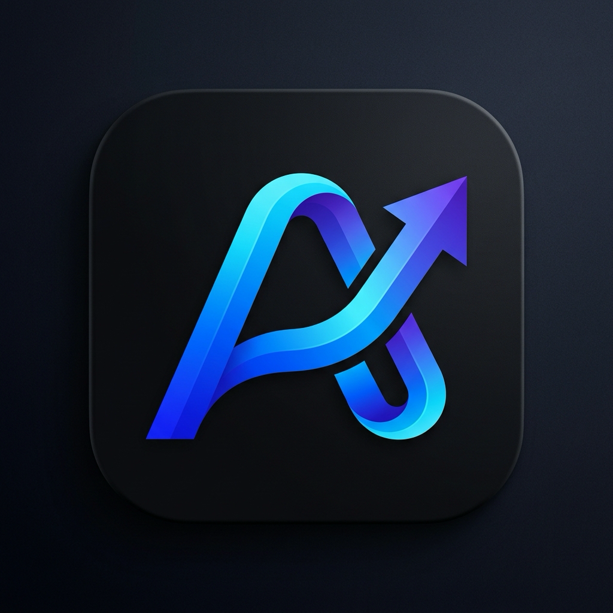
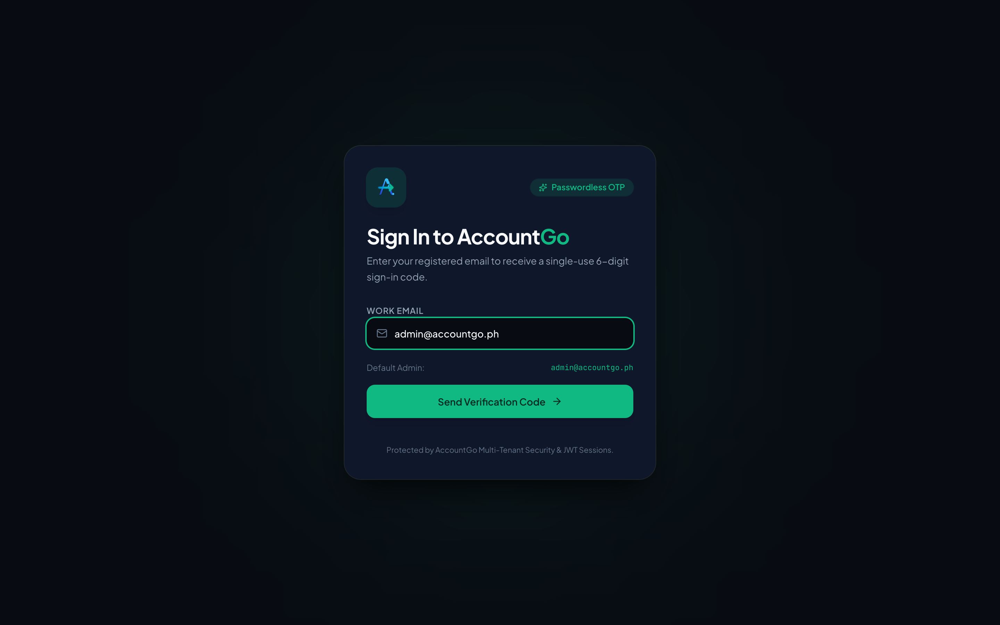
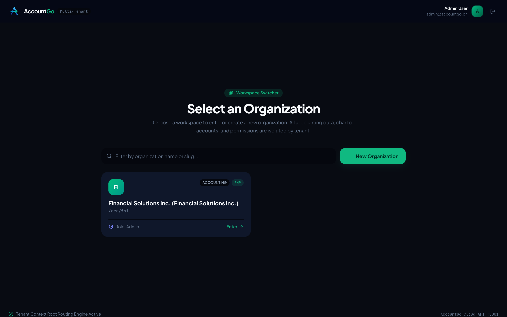
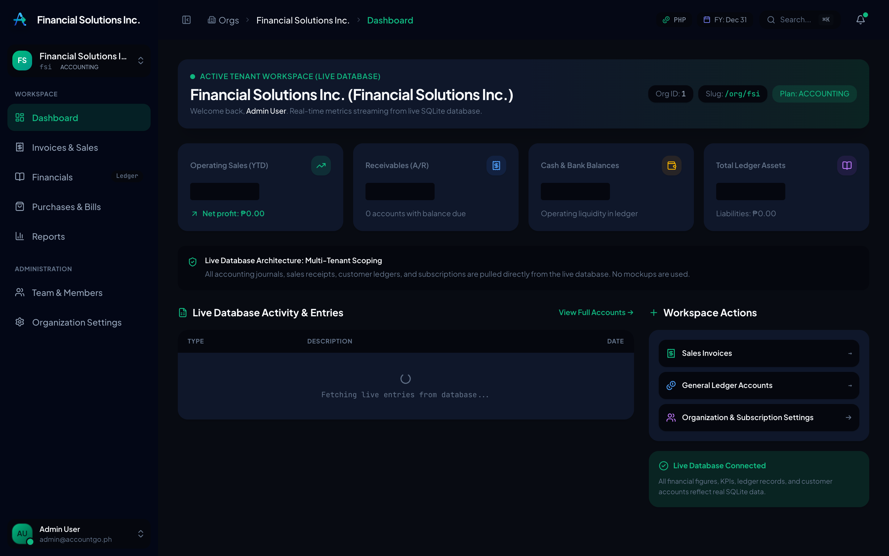
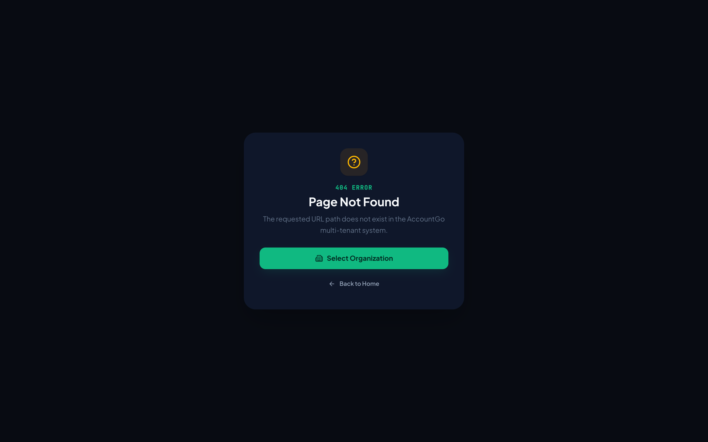
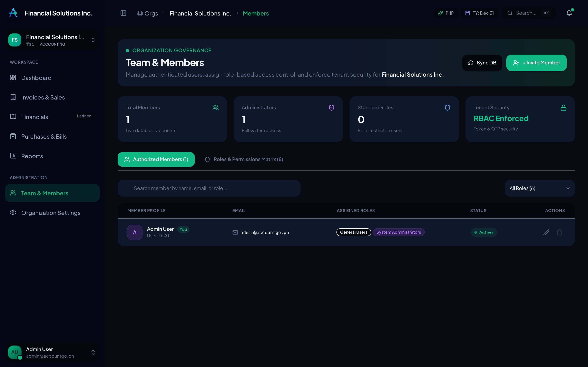
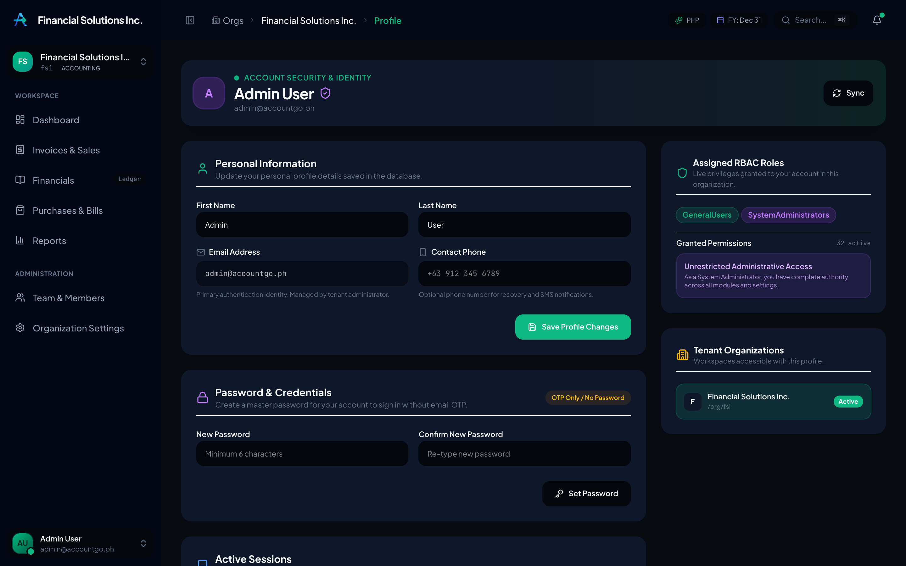

# AccountGo

<p align="center">
  
</p>

<p align="center">
  <strong>Modern, Cloud-Native, Multi-Tenant Accounting & ERP Platform</strong>
</p>

<p align="center">
  <a href="https://github.com/AccountGo/accountgo/actions/workflows/ci.yml"></a>
  
  
  
  
  
  
  <a href="LICENSE"></a>
</p>

---

## Live Deployments

- **Web Application (SPA)**: [https://app.accountgo.dev](https://app.accountgo.dev)
- **Backend API & Containers**: [https://api.accountgo.dev](https://api.accountgo.dev)

---

## Overview

**AccountGo™** is an open-source, enterprise-grade accounting and ERP suite designed for small to medium enterprises, multi-company groups, and non-profit organizations. 

Re-architected for modern cloud infrastructure, AccountGo combines a high-performance **.NET 10** backend containerized on Cloudflare edge compute with a responsive **React 19** single-page application powered by **Vite** and **Tailwind CSS v4**.

---

## User Interface Showcase

### 1. Passwordless Authentication & Magic Codes
Fast, secure sign-in with 6-digit OTP verification codes, sliding-window rate limiters, and HTTP-only session cookies.



---

### 2. Multi-Tenant Workspace Selector
Seamlessly switch between multiple companies, organizations, and branches with isolated data, custom currencies, and independent permission sets.



---

### 3. Executive Financial Dashboard
Real-time financial metrics, revenue vs. expense breakdowns, cash position, and quick navigation across accounting modules.



---

### 4. Sales & Customer Management
Manage customer directories, track accounts receivable, issue quotations, and process sales invoices with automatic tax and GL postings.


---

### 5. Financials & Chart of Accounts
Complete double-entry accounting ledger with hierarchical chart of accounts, customizable account classes, and real-time balance calculations.



---

### 6. Team & Organization Members (RBAC)
Role-based member management with support for `SystemAdministrators` and `GeneralUsers`, granular permissions, and tenant security.



---

### 7. Profile, Sessions & Security Hub
User profile management, credential administration, active device/session monitoring with single-click remote session revocation.



---

## Core Capabilities & Features

- **Multi-Tenancy & Workspace Switching**: Complete tenant isolation, custom branding, localized currencies (PHP, USD, CAD, EUR, etc.), and independent fiscal years.
- **Enterprise Security & Authentication**:
  - ASP.NET Core Identity with custom SQLite / SQL Server storage.
  - Passwordless 6-digit Email OTP / Magic Code authentication.
  - JWT access tokens + secure, HTTP-only refresh tokens.
  - Sliding-window and fixed-window rate limiters on sensitive auth endpoints.
  - Concurrent session tracking with remote session revocation.
- **Financial Accounting**:
  - Hierarchical Chart of Accounts (Assets, Liabilities, Equity, Revenue, Expenses).
  - Double-entry Journal Entries with balanced debit/credit validation.
  - Bank Accounts and Cash Management.
  - Fiscal year closing and period controls.
- **Sales & Accounts Receivable (AR)**:
  - Customers, Sales Quotations, Sales Invoices, and Payment Receipts.
  - Customer Aging reports.
- **Purchasing & Accounts Payable (AP)**:
  - Vendors, Purchase Orders, Bills, and Vendor Aging.
- **Inventory & Warehousing**:
  - Item Master, Categories, Units of Measure, and Inventory Adjustments.
- **Donations & Non-Profit Features**:
  - Donor tracking, Payment Methods (Cash, Cheque, Credit Card, E-Transfer).
  - Official Tax Receipt generation and dedicated GL account attribution.
- **Audit Trails**:
  - Comprehensive entity auditing and security event logging.

---

## Architecture & Technology Stack

```
                          ┌──────────────────────────────────────┐
                          │         Cloudflare Workers           │
                          │   (React 19 SPA Static Assets)       │
                          │          app.accountgo.dev           │
                          └──────────────────┬───────────────────┘
                                             │  /api/* Proxy
                                             ▼
                          ┌──────────────────────────────────────┐
                          │        Cloudflare Containers         │
                          │   (.NET 10 ASP.NET Core Web API)     │
                          │          api.accountgo.dev           │
                          └──────────────────┬───────────────────┘
                                             │
                      ┌──────────────────────┴──────────────────────┐
                      ▼                                             ▼
          ┌───────────────────────┐                     ┌───────────────────────┐
          │     Entity Framework  │                     │    ASP.NET Identity   │
          │   Core (Domain Data)  │                     │   (Auth, RBAC, Tokens)│
          │     accountgo.db      │                     │     accountgo.db      │
          └───────────────────────┘                     └───────────────────────┘
```

| Layer | Technologies |
| :--- | :--- |
| **Frontend** | React 19, TypeScript, Vite 8, Tailwind CSS v4, Lucide React, React Router 7 |
| **Backend API** | .NET 10, ASP.NET Core Web API, C# 14 |
| **Data Access** | Entity Framework Core 10, SQLite (edge-optimized), SQL Server support |
| **Security & Auth**| ASP.NET Core Identity, JWT Bearer, HTTP-only Refresh Cookies, Rate Limiting |
| **Orchestration** | .NET Aspire (`src.AppHost`, `src.ServiceDefaults`) |
| **Edge Compute** | Cloudflare Workers, Cloudflare Containers, Durable Objects |
| **CI / CD** | GitHub Actions CI (public); hosted Cloudflare deploy via private ops |

---

## Repository Structure

```
accountgo/
├── .github/workflows/          # Public CI + notify hosted ops (no prod resource IDs)
│   ├── ci.yml                  # Build API + Web
│   └── notify-ops.yml          # Manual notify → private AccountGo Cloud deploy
├── docs/                       # Project documentation & screenshots
│   └── screenshots/            # High-resolution application screenshots
├── src/
│   ├── Api/                    # ASP.NET Core Web API (.NET 10) & Worker adapter
│   ├── Core/                   # Domain entities, value objects, and interfaces
│   ├── Dto/                    # Data Transfer Objects for API contracts
│   ├── MigrationService/       # EF Core automated database migration runner
│   ├── Services/               # Business logic, repositories, and domain services
│   ├── src.AppHost/            # .NET Aspire local orchestration host
│   ├── src.ServiceDefaults/    # Aspire telemetry, health checks, and service discovery
│   └── Web/                    # React 19 + TypeScript + Vite + Tailwind CSS v4 SPA
└── test/
    ├── AccountGo.BackendTests/ # Domain and accounting logic tests
    └── AccountGo.ServicesTests/# Security, Administration, and Donations service tests
```

---

## Documentation

Comprehensive architecture, development, and operational guides are available in the [`docs/`](docs/) directory:

- 🏛️ [System Architecture](docs/ARCHITECTURE.md) — Multi-tenant domain model, Clean Architecture, and Cloudflare edge design.
- 💻 [Development Guide](docs/DEVELOPMENT.md) — Local workstation setup, running services, debugging, and testing.
- 🚀 [Deployment Guide](docs/DEPLOYMENT.md) — Self-host on Cloudflare Workers and Containers.
- 🔒 [Security](docs/SECURITY.md) — Disclosure and hosting posture.
- 📒 [Chart of Accounts & Posting Rules](docs/accounting/coa-register.md) — COA register, posting rules, and GAAP/IFRS controls.
- 📒 [COA Import, Export & Lifecycle](docs/accounting/coa-import-export-requirements.md) — Structure CSV, archive rules, Append/Upsert/Replace modes.
- 🧾 [General Ledger Redesign](docs/accounting/general-ledger-redesign.md) — Financials page as posted journal register (implementation brief).
- 🧪 [Double-Entry Accounting Tests](docs/accounting/double-entry-tests.md) — 7 Accuracy Guarantees and automated ledger verification suite.
- 📋 [Changelog](docs/CHANGELOG.md) — Version history and release notes.

---

## Installation

### Prerequisites

- [.NET 10 SDK](https://dotnet.microsoft.com/download/dotnet/10.0) (`net10.0`)
- [Node.js 22+](https://nodejs.org/)
- [pnpm 9+](https://pnpm.io/) (`npm install -g pnpm`)
- [Git](https://git-scm.com/)

### Clone & Install

```bash
# Clone the repository
git clone https://github.com/AccountGo/accountgo.git
cd accountgo

# Restore .NET packages
dotnet restore

# Install Web frontend dependencies
cd src/Web && pnpm install && cd ../..
```

---

## Usage & Getting Started

### 1. Running API and Web Independently (Recommended)

#### Start Backend API:
```bash
dotnet run --project src/Api/Api.csproj --urls "http://localhost:8001"
```
The API boots on `http://localhost:8001` with automated SQLite initialization and schema seeding.

#### Start Frontend Web SPA:
In a separate terminal:
```bash
cd src/Web
pnpm dev
```
Navigate to `http://localhost:3000` (or `http://localhost:5173`).

### 2. Running with .NET Aspire

```bash
dotnet run --project src/Aspire/AccountGo.AppHost/AccountGo.AppHost.csproj
```
Access the Aspire Dashboard at `http://localhost:15888` for unified telemetry, logs, and service orchestration.

### 3. Signing In & Workflows
- **Authentication**: Enter `admin@accountgo.org` on the login screen.
- **Verification Code**: Retrieve the 6-digit dev verification code logged in the API terminal (or returned in the development response `devCode`).
- **Organization Dashboard**: Access executive metrics, manage customers and sales invoices (`/org/ph-financials/sales`), track purchase bills (`/org/ph-financials/purchases`), and configure company profile and financial rules (`/org/ph-financials/settings`).

---

## Database Setup (SQLite & Multi-Engine)

### Zero-Configuration SQLite (Default)

AccountGo comes pre-configured with **SQLite** as the primary, zero-configuration database engine. You do not need to install SQL Server, MySQL, or run heavy Docker database containers to get started.

- **Configuration**: Set in [`src/Api/appsettings.json`](src/Api/appsettings.json):
  ```json
  "DatabaseProvider": "Sqlite",
  "ConnectionStrings": {
    "SqliteConnection": "Data Source=accountgo.db"
  }
  ```
- **Automated Lifecycle on API Startup**:
  1. **Automatic Database Creation**: If `accountgo.db` does not exist, EF Core automatically creates the file on startup.
  2. **Schema Generation**: Automatically executes table creation for both `ApiDbContext` (business domains) and `ApplicationIdentityDbContext` (ASP.NET Identity auth, users, and refresh tokens).
  3. **Initial Data Seeding**: Populates initial chart of accounts, company setup ("Financial Solutions Inc."), tax configurations, default vendors, customers, items, banks, and RBAC roles (`SystemAdministrators`, `GeneralUsers`).
  4. **Admin User Provisioning**: Guarantees `admin@accountgo.ph` is seeded and initialized with master administrative permissions.

### Resetting or Re-seeding the Database
To reset the database back to clean seeded defaults at any time:
```bash
# Remove local SQLite database and write-ahead logs
rm -f src/Api/accountgo.db*

# Start the API - it will automatically recreate and reseed
cd src/Api && dotnet run
```

### Inspecting the SQLite Database
You can query and explore the database directly using the SQLite CLI or visual tools:
```bash
sqlite3 src/Api/accountgo.db ".tables"
sqlite3 src/Api/accountgo.db "SELECT Name, ShortName, Slug FROM Company;"
sqlite3 src/Api/accountgo.db "SELECT UserName, Email FROM AspNetUsers;"
```
Visual tools supported:
- **VS Code**: SQLite Viewer or SQLite Explorer extension
- **GUI**: [DB Browser for SQLite](https://sqlitebrowser.org/)

### Switching to Microsoft SQL Server (Optional)
If you prefer running against Microsoft SQL Server for enterprise deployments:
1. Set the environment variable `DBPROVIDER=SqlServer` (or edit `DatabaseProvider` in [`src/Api/appsettings.json`](src/Api/appsettings.json)).
2. Configure your connection string in `ConnectionStrings:DefaultConnection`.
3. Start the API — EF Core will automatically target your SQL Server instance.

---

## Running Automated Tests

AccountGo includes a comprehensive automated test suite covering domain entities, accounting algorithms, RBAC security, and service boundaries:

```bash
# Run all 99 automated tests across the solution
dotnet test
```

```bash
# Test frontend compilation and type-safety
cd src/Web
pnpm run build
```

---

## Deployment to Cloudflare

**AccountGo Cloud** (`*.accountgo.dev`) is deployed from a private ops repository. This public repo runs CI only; hosted deploys are triggered manually (ops SHA deploy or Actions → Notify ops to deploy).

**Self-host:** copy `src/*/wrangler.example.jsonc` → `wrangler.jsonc`, set your domains, then add the `ConnectionStrings__PostgresConnection` secret and:

```bash
cd src/Api && pnpm install && npx wrangler deploy
cd src/Web && pnpm install && pnpm build && pnpm run deploy
```

See [docs/DEPLOYMENT.md](docs/DEPLOYMENT.md).

---

## Contributing

Contributions, issues, and feature requests are welcome! We appreciate help making AccountGo the leading open-source accounting platform.

- 📖 **Contribution Guidelines**: Please review our [Contributing Guide](CONTRIBUTING.md) for branch naming, coding standards, and testing expectations.
- 🤝 **Code of Conduct**: All participants are expected to adhere to our [Code of Conduct](CODE_OF_CONDUCT.md).
- 🔒 **Security Disclosures**: Found a vulnerability? Please follow our [Security Policy](SECURITY.md) instead of filing a public issue.
- 🐛 **Issue Tracker**: Report bugs and propose features on the [GitHub Issues](https://github.com/AccountGo/accountgo/issues) page using our templates.

---

## Author & Maintainer

**AccountGo** was created and is actively maintained by **Marvin Perez**.

- ✉️ **Email**: [support@accountgo.dev](mailto:support@accountgo.dev)
- 🌐 **GitHub**: [@mvperez](https://github.com/mvperez) / [AccountGo](https://github.com/AccountGo)

---

## License

This project is licensed under the **GNU Affero General Public License v3.0 only (AGPL-3.0-only)**. See the [LICENSE](LICENSE) file for the full license text and [NOTICE](NOTICE) for copyright and license history.

If you modify AccountGo and let users interact with it over a network, the AGPL requires you to offer those users the corresponding source code of your modified version.

### Trademarks

"AccountGo", "AccountGo Cloud", and the AccountGo logos are trademarks of Marvin Perez and are **not** covered by the AGPL. Forks and third-party hosted services must use a different name and remove the AccountGo logos. See [TRADEMARKS.md](TRADEMARKS.md).
