# AccountGo

<p align="center">
  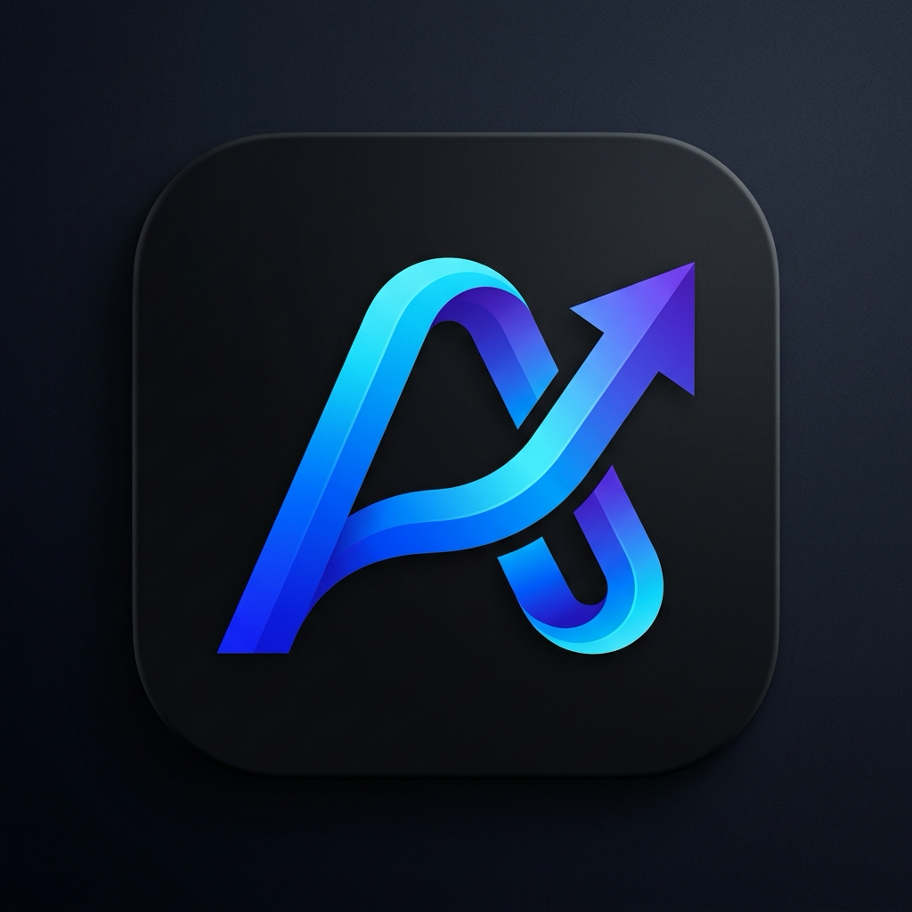
</p>

<p align="center">
  <strong>Modern, Cloud-Native, Multi-Tenant Accounting & ERP Platform</strong>
</p>

<p align="center">
  <a href="https://github.com/AccountGo/accountgo/actions/workflows/ci.yml"></a>
  
  
  
  
  
  
  <a href="LICENSE"></a>
  <a href="https://buymeacoffee.com/marvinperez"></a>
</p>

---

## Live Deployments

- **Web Application (SPA)**: [https://app.accountgo.dev](https://app.accountgo.dev)
- **Backend API & Containers**: [https://api.accountgo.dev](https://api.accountgo.dev)

---

## Overview

**AccountGo™** is an open-source, enterprise-grade accounting and ERP suite designed for small to medium enterprises, multi-company groups, and non-profit organizations. 

Re-architected for modern cloud infrastructure, AccountGo combines a high-performance **.NET 10** backend containerized on Cloudflare edge compute with a responsive **React 19** single-page application powered by **Vite** and **Tailwind CSS v4**.

---

## User Interface Showcase

### 1. Passwordless Authentication & Magic Codes
Fast, secure sign-in with 6-digit OTP verification codes, sliding-window rate limiters, and HTTP-only session cookies.

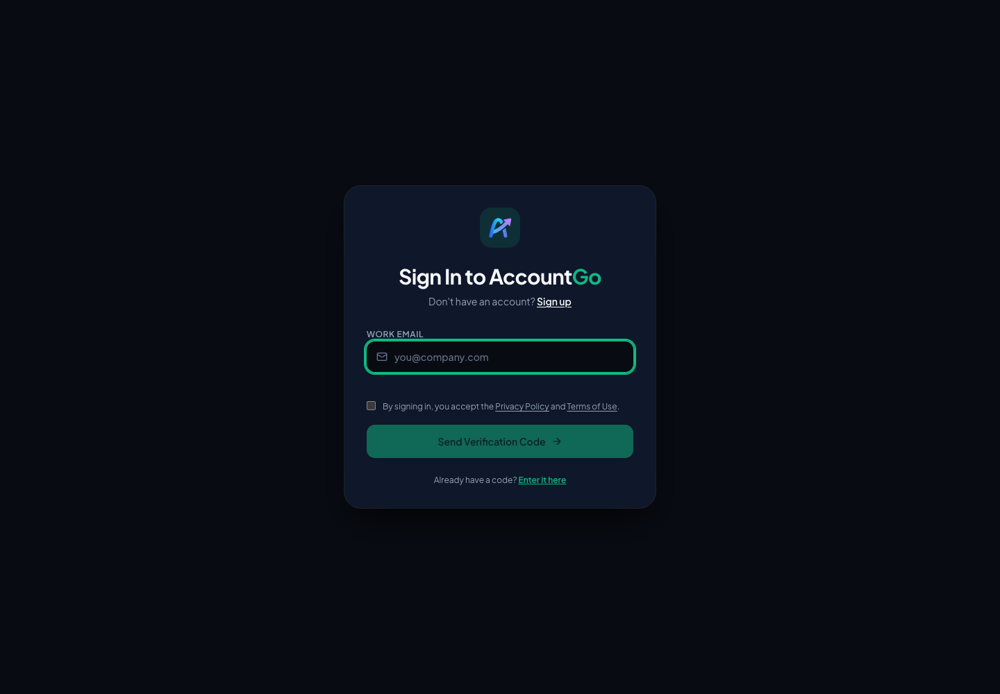

---

### 2. Multi-Tenant Workspace Selector
Seamlessly switch between multiple companies, organizations, and branches with isolated data, custom currencies, and independent permission sets.

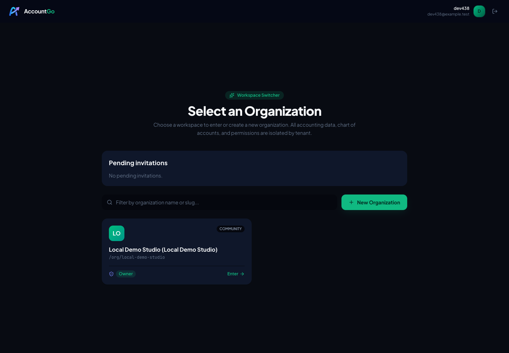

---

### 3. Executive Financial Dashboard
Real-time financial metrics, revenue vs. expense breakdowns, cash position, and quick navigation across accounting modules.

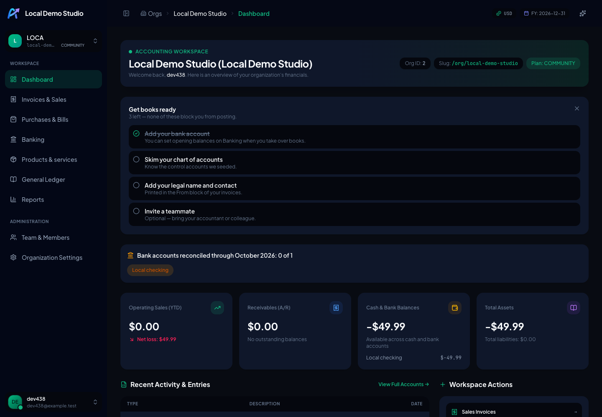

---

### 4. Sales & Customer Management
Manage customer directories, track accounts receivable, issue quotations, and process sales invoices with automatic tax and GL postings.

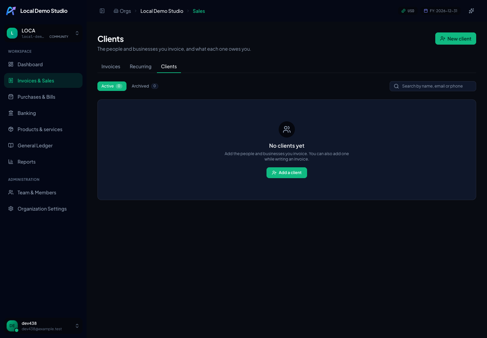

---

### 5. Financials & Chart of Accounts
Complete double-entry accounting ledger with hierarchical chart of accounts, customizable account classes, and real-time balance calculations.

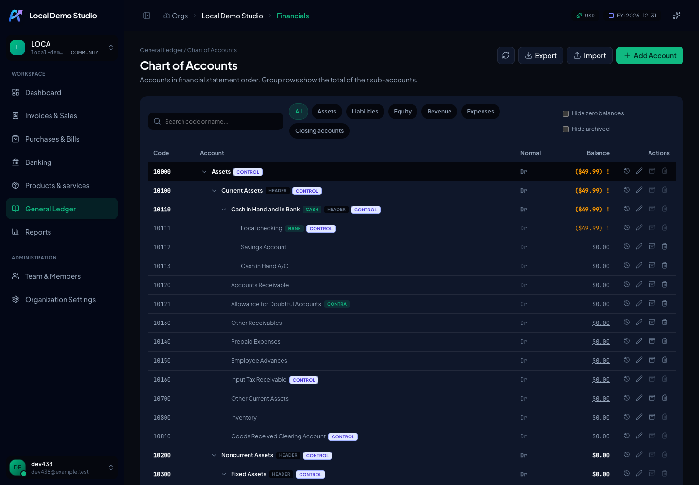

---

### 6. Team & Organization Members (RBAC)
Role-based member management with support for `SystemAdministrators` and `GeneralUsers`, granular permissions, and tenant security.

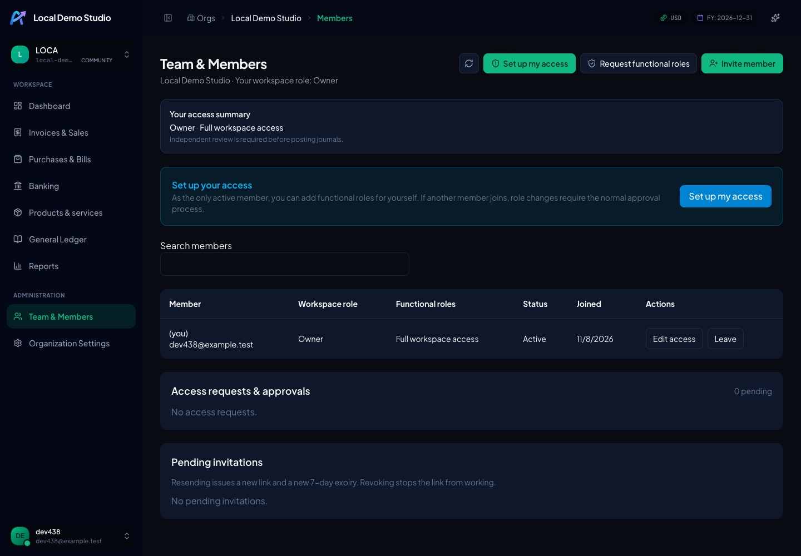

---

### 7. Profile, Sessions & Security Hub
User profile management, credential administration, active device/session monitoring with single-click remote session revocation.

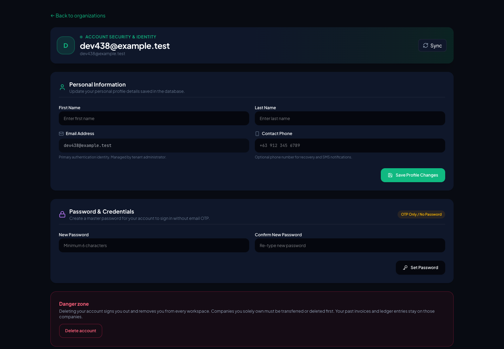

---

### 8. Mobile & Installable App (PWA)
Add AccountGo to your phone's home screen and it runs full-screen like a native app, with a bottom tab bar, a slide-out menu, and layouts that respect the iPhone notch and home indicator.

<p align="center">
  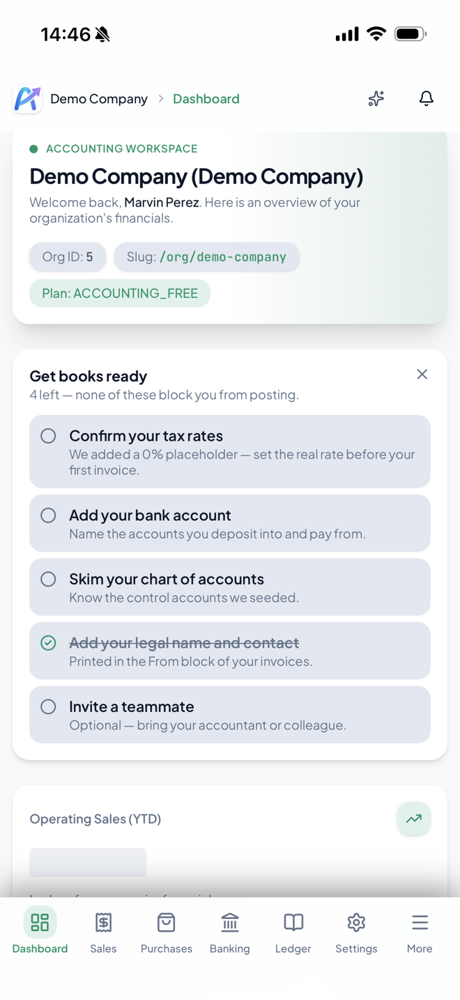
  &nbsp;
  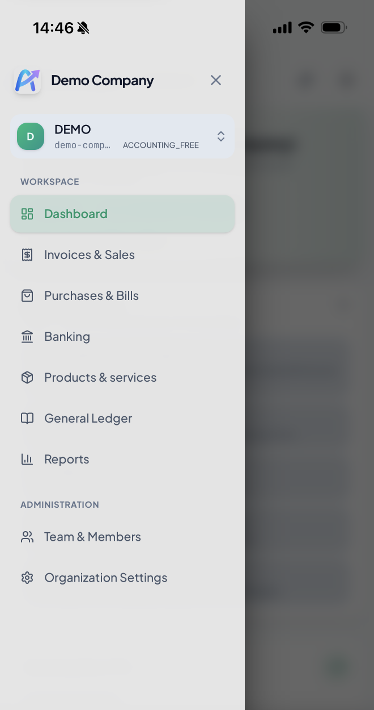
  &nbsp;
  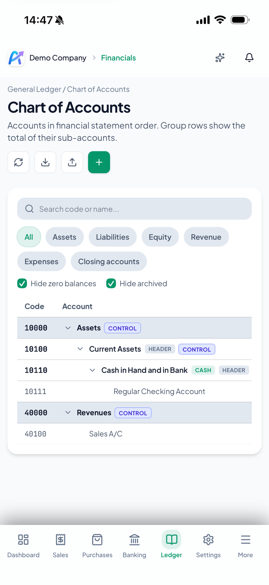
</p>

---

## Core Capabilities & Features

- **Multi-Tenancy & Workspace Switching**: Complete tenant isolation, custom branding, localized currencies (PHP, USD, CAD, EUR, etc.), and independent fiscal years.
- **Enterprise Security & Authentication**:
  - ASP.NET Core Identity with custom SQLite / SQL Server storage.
  - Passwordless 6-digit Email OTP / Magic Code authentication.
  - JWT access tokens + secure, HTTP-only refresh tokens.
  - Sliding-window and fixed-window rate limiters on sensitive auth endpoints.
  - Concurrent session tracking with remote session revocation.
- **Financial Accounting**:
  - Hierarchical Chart of Accounts (Assets, Liabilities, Equity, Revenue, Expenses).
  - Double-entry Journal Entries with balanced debit/credit validation.
  - Bank Accounts and Cash Management.
  - Fiscal year closing and period controls.
- **Sales & Accounts Receivable (AR)**:
  - Customers, Sales Quotations, Sales Invoices, and Payment Receipts.
  - Customer Aging reports.
- **Purchasing & Accounts Payable (AP)**:
  - Vendors, Purchase Orders, Bills, and Vendor Aging.
- **Inventory & Warehousing**:
  - Item Master, Categories, Units of Measure, and Inventory Adjustments.
- **Donations & Non-Profit Features**:
  - Donor tracking, Payment Methods (Cash, Cheque, Credit Card, E-Transfer).
  - Official Tax Receipt generation and dedicated GL account attribution.
- **Audit Trails**:
  - Comprehensive entity auditing and security event logging.

---

## Architecture & Technology Stack

```
                          ┌──────────────────────────────────────┐
                          │         Cloudflare Workers           │
                          │   (React 19 SPA Static Assets)       │
                          │          app.accountgo.dev           │
                          └──────────────────┬───────────────────┘
                                             │  /api/* Proxy
                                             ▼
                          ┌──────────────────────────────────────┐
                          │        Cloudflare Containers         │
                          │   (.NET 10 ASP.NET Core Web API)     │
                          │          api.accountgo.dev           │
                          └──────────────────┬───────────────────┘
                                             │
                      ┌──────────────────────┴──────────────────────┐
                      ▼                                             ▼
          ┌───────────────────────┐                     ┌───────────────────────┐
          │     Entity Framework  │                     │    ASP.NET Identity   │
          │   Core (Domain Data)  │                     │   (Auth, RBAC, Tokens)│
          │  SQLite / PostgreSQL  │                     │  SQLite / PostgreSQL  │
          └───────────────────────┘                     └───────────────────────┘
```

| Layer | Technologies |
| :--- | :--- |
| **Frontend** | React 19, TypeScript, Vite 8, Tailwind CSS v4, Lucide React, React Router 7 |
| **Backend API** | .NET 10, ASP.NET Core Web API, C# 14 |
| **Data Access** | Entity Framework Core 10, SQLite, PostgreSQL, SQL Server support |
| **Security & Auth**| ASP.NET Core Identity, JWT Bearer, HTTP-only Refresh Cookies, Rate Limiting |
| **Orchestration** | .NET Aspire (`src.AppHost`, `src.ServiceDefaults`) |
| **Edge Compute** | Cloudflare Workers, Cloudflare Containers, Durable Objects |
| **CI / CD** | GitHub Actions CI (public); hosted Cloudflare deploy via private ops |

---

## Repository Structure

```
accountgo/
├── .github/workflows/          # Public CI + notify hosted ops (no prod resource IDs)
│   ├── ci.yml                  # Build API + Web
│   └── notify-ops.yml          # Manual notify → private AccountGo Cloud deploy
├── docs/                       # Project documentation & screenshots
│   └── screenshots/            # High-resolution application screenshots
├── src/
│   ├── Api/                    # ASP.NET Core Web API (.NET 10) & Worker adapter
│   ├── Core/                   # Domain entities, value objects, and interfaces
│   ├── Dto/                    # Data Transfer Objects for API contracts
│   ├── MigrationService/       # EF Core automated database migration runner
│   ├── Services/               # Business logic, repositories, and domain services
│   ├── src.AppHost/            # .NET Aspire local orchestration host
│   ├── src.ServiceDefaults/    # Aspire telemetry, health checks, and service discovery
│   └── Web/                    # React 19 + TypeScript + Vite + Tailwind CSS v4 SPA
└── test/
    ├── AccountGo.BackendTests/ # Domain and accounting logic tests
    └── AccountGo.ServicesTests/# Security, Administration, and Donations service tests
```

---

## Documentation

Comprehensive architecture, development, and operational guides are available in the [`docs/`](docs/) directory:

- 🏛️ [System Architecture](docs/ARCHITECTURE.md) — Multi-tenant domain model, Clean Architecture, and Cloudflare edge design.
- 💻 [Development Guide](docs/DEVELOPMENT.md) — Local workstation setup, running services, debugging, and testing.
- 🚀 [Deployment Guide](docs/DEPLOYMENT.md) — Self-host on Cloudflare Workers and Containers.
- 🔒 [Security](docs/SECURITY.md) — Disclosure and hosting posture.
- 📒 [Chart of Accounts & Posting Rules](docs/accounting/coa-register.md) — COA register, posting rules, and GAAP/IFRS controls.
- 📒 [COA Import, Export & Lifecycle](docs/accounting/coa-import-export-requirements.md) — Structure CSV, archive rules, Append/Upsert/Replace modes.
- 🧾 [General Ledger Redesign](docs/accounting/general-ledger-redesign.md) — Financials page as posted journal register (implementation brief).
- 🧪 [Double-Entry Accounting Tests](docs/accounting/double-entry-tests.md) — 7 Accuracy Guarantees and automated ledger verification suite.
- 📋 [Changelog](docs/CHANGELOG.md) — Version history and release notes.
- 🏷️ [Releasing](docs/RELEASING.md) — How changes are recorded and releases are cut.

---

## Run locally: API, web, and database

These steps start the community edition on your own machine. Commands use a POSIX shell (macOS or Linux); on Windows use WSL. Starting the API initializes the selected database and seeds a new one. Use a disposable local database: the examples are not production settings. Package restore downloads dependencies; local authentication uses a console email sender when no Resend key is configured. External email, payment checkout, Google sign-in, and the assistant need their own service configuration.

### 1. Install prerequisites and clone

Install Git, the .NET 10 SDK, Node.js 22.22.2+, 24.15.0+, or 26+, pnpm 12, and OpenSSL. SQLite is built into the API; the `sqlite3` command-line tool is optional. For PostgreSQL, install PostgreSQL and its client tools, or run a local PostgreSQL server with Docker. Verify:

```bash
git --version
dotnet --version
node --version
pnpm --version
openssl version
```

```bash
git clone https://github.com/AccountGo/accountgo.git
cd accountgo
dotnet restore
cd src/Web
pnpm install --frozen-lockfile
cd ../..
```

### 2. Configure the API

Create `src/Api/.env` from the repository root. This file is local and must not be committed. Generate separate keys and keep them across API restarts; changing `SECRET_KEY` invalidates existing sessions. The API's `.env` loader overrides values with the same names from the shell, so edit this file when changing providers. Set `ASPNETCORE_ENVIRONMENT` in the shell command below: the hosting environment is selected before `.env` is loaded.

```bash
umask 077
printf 'SECRET_KEY=%s\nINTERNAL_SYNC_KEY=%s\nPUBLIC_WEB_URL=http://localhost:3000\nPUBLIC_API_URL=http://localhost:8001\n' \
  "$(openssl rand -hex 32)" "$(openssl rand -hex 32)" > src/Api/.env
```

The local settings in this file are:

| Setting | Purpose |
| --- | --- |
| `SECRET_KEY` | Signs authentication tokens and codes; required and at least 32 bytes. |
| `INTERNAL_SYNC_KEY` | Separate key for internal sync endpoints. |
| `PUBLIC_WEB_URL`, `PUBLIC_API_URL` | Local origins used in invitation and signed invoice links. |
| `DBPROVIDER` | Selects `Sqlite` or `Postgres`. |
| `ConnectionStrings:SqliteConnection`, `ConnectionStrings:PostgresConnection` | Connection string for the chosen provider. |
| `SEED_DEMO_DATA` | Optional PostgreSQL first-start seed control; defaults to enabled. |
| `ASPNETCORE_ENVIRONMENT` | Set to `Development` in the API process environment, before startup. |

Do not copy the placeholder Resend key from `.env.example`: an absent `RESEND_API_KEY` selects the development console sender. The sample file documents optional email and assistant settings. `.env` is parsed as simple `KEY=value` lines, not executed as shell code; do not put command substitutions in it. Use colon-separated configuration keys in this file (for example `ConnectionStrings:PostgresConnection`). When exporting configuration directly in the shell, use double underscores instead (for example `ConnectionStrings__PostgresConnection`).

Choose **one** database below. Both the application data and identity data use the selected database.

#### SQLite

```bash
printf '\nDBPROVIDER=Sqlite\nConnectionStrings:SqliteConnection=Data Source=accountgo.db;Foreign Keys=True\n' >> src/Api/.env
```

The relative database path is resolved from the API content root, `src/Api`. On its first start the API creates and seeds `src/Api/accountgo.db`; startup upgrades existing SQLite schema. For an isolated file, supply an absolute path in the connection string. Back up local data before deleting or replacing it.

#### PostgreSQL

Start a PostgreSQL server and create an empty database and a login with permission to create tables, indexes, and run migrations. For example, on a workstation with Docker:

```bash
docker run --name accountgo-postgres -e POSTGRES_USER=accountgo \
  -e POSTGRES_PASSWORD=localdevpassword -e POSTGRES_DB=accountgo_local \
  -p 127.0.0.1:5432:5432 -v accountgo-postgres-data:/var/lib/postgresql/data \
  -d postgres:17
```

Wait for PostgreSQL to accept connections (`docker logs accountgo-postgres`). If port 5432 is in use, choose another host port and update the connection string. The credentials below are local examples; replace them if you use an existing server.

```bash
printf '\nDBPROVIDER=Postgres\nConnectionStrings:PostgresConnection=Host=localhost;Port=5432;Database=accountgo_local;Username=accountgo;Password=localdevpassword\n' >> src/Api/.env
```

If switching from SQLite, **replace** its `DBPROVIDER` line rather than leaving duplicate provider settings. The API applies PostgreSQL migrations on startup and seeds demo data into a new database. Set `SEED_DEMO_DATA=false` before first startup to omit demo books. Never point this local example at a production database.

### 3. Start both processes

From the repository root, start the API in terminal 1 and leave it running:

```bash
ASPNETCORE_ENVIRONMENT=Development dotnet run --no-launch-profile --project src/Api/Api.csproj --urls http://localhost:8001
```

Wait for `Now listening on: http://localhost:8001`. In terminal 2, from the repository root:

```bash
cd src/Web
pnpm dev --host 127.0.0.1
```

Open **http://localhost:3000**. Vite proxies `/api` to `http://localhost:8001`; changing the API port requires updating the proxy in `src/Web/vite.config.ts`. Use the same `localhost` hostname for browser and API. Stop either process with Ctrl+C.

### 4. Sign in and enable your workspace screens

1. On the sign-in page choose **Sign up**, enter a local test email, accept the terms, and choose **Create Account & Send Code**.
2. With `ASPNETCORE_ENVIRONMENT=Development` set in the API command and no Resend key, the development code appears on the verification screen and is auto-filled. Choose **Complete Sign-Up & Enter**. For a later login, request a new code and choose **Verify & Enter AccountGo**. This account exists only in your selected local database.
3. Choose **New Organization**, select **Community**, and complete the workspace name, currency, books-start date, fiscal-year and reporting screens. Choose **Create workspace**. For test transactions dated in the past, choose a books-start date no later than those transactions.
4. Open **Team & Members → Set up my access**. For a disposable development workspace, select **Full workspace access** and choose **Save and activate roles**. An Owner workspace role grants administration; functional roles grant access to banking, sales, purchasing, reports, and other operational screens. Assign only the roles appropriate to the user in a real workspace. Journal posting can still require independent review.
5. Open **Banking → Add bank account**, provide a name and currency, and save. Open the account and choose **Import statement** to test file preview and import. The sidebar exposes the modules granted by the functional role and the workspace's enabled modules.

The local console sender does not send real email. If the code does not appear, check that the API is in Development and no `RESEND_API_KEY` is configured, then inspect its terminal output. Paid hosted plans, hosted plan gates and external integrations cannot all be reproduced by the community configuration alone.

### Database and startup troubleshooting

- **Signing-key error:** ensure `SECRET_KEY` in `src/Api/.env` is at least 32 bytes, then restart the API.
- **Connection refused or migrations fail:** check the selected provider, PostgreSQL server, credentials, database privileges, and API log. A second API process cannot bind the same port.
- **Screens missing or 403:** check the active workspace, **Team & Members** functional roles, and enabled modules. Owner alone does not grant all operational permissions.
- **Vite shows a proxy error:** confirm the API is listening on port 8001 and Vite on port 3000.
- **Switch databases:** stop the API, update `.env` to one provider and its connection string, and restart. Each database has separate users and workspaces.
- **Reset a disposable SQLite database:** stop the API, back up anything needed, and remove the selected SQLite file and its matching `-wal` and `-shm` files. Restart to create a new database. For PostgreSQL, create a separate empty database; do not drop a database containing data you need.

### Tests

From the repository root:

```bash
dotnet test test/AccountGo.BackendTests/AccountGo.BackendTests.csproj
cd src/Web
pnpm test
pnpm build
```

The focused statement-import suite can be run with `dotnet test test/AccountGo.BackendTests/AccountGo.BackendTests.csproj --filter 'FullyQualifiedName~BankStatementParserTests|FullyQualifiedName~BankStatementImportServiceTests|FullyQualifiedName~StatementIncomeRecorderTests|FullyQualifiedName~MultiTenancyPhase3Tests.Acceptance_'`. Automated tests do not replace checking the full browser flow and external service integrations.

---

## Deployment to Cloudflare

**AccountGo Cloud** (`*.accountgo.dev`) is deployed from a private ops repository. This public repo runs CI only; hosted deploys are triggered manually (ops SHA deploy or Actions → Notify ops to deploy).

**Self-host:** copy `src/*/wrangler.example.jsonc` → `wrangler.jsonc`, set your domains, then add the `ConnectionStrings:PostgresConnection` secret and:

```bash
cd src/Api && pnpm install && npx wrangler deploy
cd src/Web && pnpm install && pnpm build && pnpm run deploy
```

See [docs/DEPLOYMENT.md](docs/DEPLOYMENT.md).

---

## Support AccountGo

AccountGo's open-source core is built and maintained by one person. If it's useful to you, these all help:

- ⭐ **Star the repository** so more people find it.
- 🐛 **Report bugs and suggest features** on [GitHub Issues](https://github.com/AccountGo/accountgo/issues).
- 🛠️ **Contribute** code, docs, or translations (see [Contributing](#contributing)).
- ☁️ **Use [AccountGo Cloud](https://accountgo.dev/pricing/)** if you'd rather not self-host. Paid plans fund development directly.
- ☕ **[Buy me a coffee](https://buymeacoffee.com/marvinperez)** if you'd like to say thanks.

A coffee is a personal thank-you to the maintainer. It isn't a tax-deductible donation, and it doesn't buy features, priority support, roadmap influence, or any licence or trademark rights. For support or commercial terms, email [support@accountgo.dev](mailto:support@accountgo.dev).

---

## Contributing

Contributions, issues, and feature requests are welcome! We appreciate help making AccountGo the leading open-source accounting platform.

- 📖 **Contribution Guidelines**: Please review our [Contributing Guide](CONTRIBUTING.md) for branch naming, coding standards, and testing expectations.
- 🤝 **Code of Conduct**: All participants are expected to adhere to our [Code of Conduct](CODE_OF_CONDUCT.md).
- 🔒 **Security Disclosures**: Found a vulnerability? Please follow our [Security Policy](SECURITY.md) instead of filing a public issue.
- 🐛 **Issue Tracker**: Report bugs and propose features on the [GitHub Issues](https://github.com/AccountGo/accountgo/issues) page using our templates.

---

## Author & Maintainer

**AccountGo** was created and is actively maintained by **Marvin Perez**.

- ✉️ **Email**: [support@accountgo.dev](mailto:support@accountgo.dev)
- 🌐 **GitHub**: [@mvperez](https://github.com/mvperez) / [AccountGo](https://github.com/AccountGo)

---

## License

This project is licensed under the **GNU Affero General Public License v3.0 only (AGPL-3.0-only)**. See the [LICENSE](LICENSE) file for the full license text and [NOTICE](NOTICE) for copyright and license history.

If you modify AccountGo and let users interact with it over a network, the AGPL requires you to offer those users the corresponding source code of your modified version.

### Trademarks

"AccountGo", "AccountGo Cloud", and the AccountGo logos are trademarks of Marvin Perez and are **not** covered by the AGPL. Forks and third-party hosted services must use a different name and remove the AccountGo logos. See [TRADEMARKS.md](TRADEMARKS.md).
