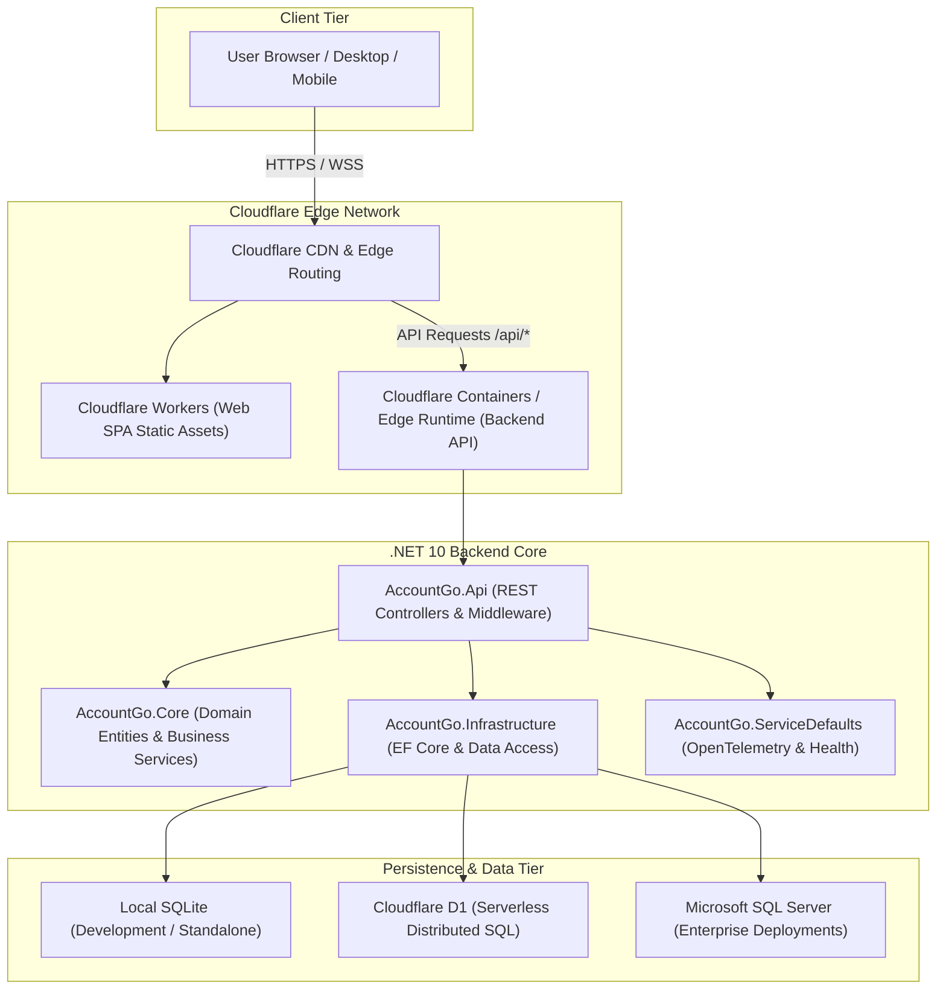
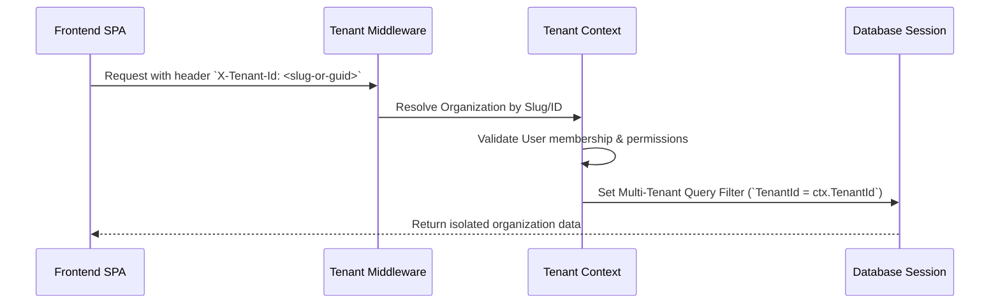

# AccountGo Architecture & System Design

This document details the architectural principles, component structure, and operational topology of the **AccountGo** platform.

---

## 1. System Overview

AccountGo is a cloud-native, multi-tenant accounting and Enterprise Resource Planning (ERP) platform designed for modern business operations. The solution is partitioned into a high-performance .NET 10 API backend and a React 19 single-page application (SPA), running either locally, in containers, or deployed globally across Cloudflare edge compute.



---

## 2. Backend Architecture (Clean Architecture / DDD)

The backend follows the principles of **Clean Architecture** and **Domain-Driven Design (DDD)**, maintaining strict separation of concerns and dependency inversion:

```
src/
├── Api/                 # Presentation layer: ASP.NET Core controllers, middleware, auth handlers
├── Core/                # Domain layer: Entities, value objects, domain interfaces, business rules
├── Infrastructure/      # Data access layer: EF Core DbContext, repositories, external integrations
├── Aspire/              # Orchestration & App Host (.NET Aspire 10)
└── src.ServiceDefaults/ # Shared telemetry, OpenTelemetry, logging, and health check endpoints
```

### Dependency Rules
- **AccountGo.Core**: Has **zero** external dependencies on databases or UI frameworks. Contains core accounting rules (double-entry bookkeeping, ledger validation, tax calculation, financial year boundaries).
- **AccountGo.Infrastructure**: Implements domain repository interfaces using Entity Framework Core. Handles connection multiplexing across SQLite, Cloudflare D1, and SQL Server.
- **AccountGo.Api**: Orchestrates incoming HTTP requests, performs authentication and claims resolution, binds multi-tenant context, and delegates business operations to domain services.

---

## 3. Multi-Tenancy Model

AccountGo supports complete data and operational isolation across multiple legal organizations (companies):



### Key Multi-Tenancy Features:
1. **Tenant Resolution**: Handled via the `X-Tenant-Id` HTTP header or route parameters (`/org/:orgSlug/*`).
2. **Global Query Filters**: Entity Framework Core applies global filters (`e => e.CompanyId == currentCompanyId`) on all tenant-scoped entities.
3. **Multi-Currency Support**: Each organization configures its base reporting currency (e.g., `USD`, `PHP`, `CAD`, `EUR`) alongside customizable exchange rates.

---

## 4. Frontend Web Architecture

The frontend (`src/Web`) is built with modern web technologies:
- **React 19**: Modern declarative UI with hooks, transitions, and suspense.
- **TypeScript 5.9+**: Strict type definitions covering all DTOs and API contracts.
- **Vite 8**: Ultra-fast module bundling and Hot Module Replacement (HMR).
- **Tailwind CSS v4**: Utility-first CSS using CSS variables and modern glassmorphic tokens.
- **React Router 7**: Declarative routing with nested layouts and route guards.

### Frontend Layers:
```
src/Web/src/
├── components/          # Reusable UI components (Modals, Tables, Forms, Layouts)
├── contexts/            # React contexts: AuthContext, TenantContext, ThemeContext
├── pages/               # Route views: Dashboard, Sales, Purchases, Financials, Settings
├── services/            # API clients using Fetch with Bearer authentication
└── types/               # TypeScript models matching backend C# DTOs
```

---

## 5. Authentication & Security Architecture

1. **Passwordless OTP Authentication**:
   - Eliminates stored password vulnerabilities.
   - Users authenticate via 6-digit cryptographic verification codes sent via email or generated in development mode (`devCode`).
2. **Session Security**:
   - Access tokens issued as standard signed JWTs.
   - Refresh tokens stored with automatic rotation and revocation.
   - Sliding-window rate limiters prevent brute-force attacks on OTP endpoints.
3. **Role-Based Access Control (RBAC)**:
   - Built-in roles: `SystemAdministrators`, `GeneralUsers`, `Accountant`, `Sales Representative`, `Purchasing Agent`, `Auditor / Viewer`.
   - Granular permission matrix controlling read, write, post, and delete privileges across Sales, Purchases, Financials, and Administration.

---

## 6. Persistence & Storage Abstraction

AccountGo supports pluggable database backends:
- **SQLite (Default)**: Zero-configuration file database (`accountgo.db`) with Write-Ahead Logging (`WAL`) enabled for fast concurrent reads and writes.
- **Cloudflare D1**: Serverless SQLite distributed database matching the local schema for edge operations.
- **Microsoft SQL Server**: Enterprise production storage for high-volume transactions.
