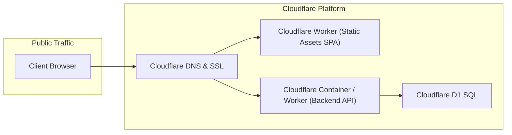

# Deployment Guide

This guide covers deploying **AccountGo** to production environments, with a focus on Cloudflare Workers, Cloudflare Containers, and containerized Docker environments.

---

## 1. Deployment Architecture



---

## 2. Deploying Frontend Web to Cloudflare Workers

The frontend Single Page Application is packaged and deployed using Cloudflare Wrangler.

### Prerequisites:
- Cloudflare account with API token.
- Wrangler CLI installed (`npm install -g wrangler` or via `pnpm dlx wrangler`).

### Deployment Steps:
```bash
cd src/Web

# 1. Install dependencies
pnpm install

# 2. Build production assets
pnpm build

# 3. Deploy via Wrangler
pnpm wrangler deploy
```

The output URL will be published to your Workers domain (e.g., `https://accountgo-web.<your-subdomain>.workers.dev`).

---

## 3. Deploying Backend API (.NET 10)

The backend API is containerized using Docker and deployed to Cloudflare Containers or any container host (e.g., AWS ECS, Google Cloud Run, Azure Container Apps, Kubernetes).

### Docker Build & Run:

1. **Build Container Image**:
   ```bash
   docker build -t accountgo-api:latest -f src/Api/Dockerfile .
   ```

2. **Run Container Locally**:
   ```bash
   docker run -d \
     -p 8001:8001 \
     -e ASPNETCORE_ENVIRONMENT=Production \
     -e ASPNETCORE_URLS=http://+:8001 \
     --name accountgo-api \
     accountgo-api:latest
   ```

3. **Deploying to Cloudflare Containers**:
   ```bash
   # Push image to container registry
   docker tag accountgo-api:latest registry.cloudflare.com/<your-account>/accountgo-api:latest
   docker push registry.cloudflare.com/<your-account>/accountgo-api:latest

   # Deploy worker container configuration via Wrangler
   cd src/Api
   wrangler deploy
   ```

---

## 4. Environment Variables & Secrets

Configure the following environment variables in production:

| Variable | Description | Example / Default |
| -------- | ----------- | ----------------- |
| `ASPNETCORE_ENVIRONMENT` | Application environment | `Production` |
| `ASPNETCORE_URLS` | Binding URLs and ports | `http://+:8001` |
| `SECRET_KEY` | 256-bit cryptographic secret for JWT signing & OTP verification | 256-bit secure secret key |
| `RESEND_API_KEY` | API key for Resend email service | `re_123456789...` |
| `EMAIL_PROVIDER` | Email provider selection (`Resend` or dev fallback) | `Resend` |
| `ConnectionStrings__DefaultConnection` | Database connection string (ASP.NET hierarchy) | `Data Source=accountgo.db` or MSSQL connection string |
| `JwtSettings__validIssuer` | Token issuer domain (ASP.NET hierarchy) | `AccountGo API` |
| `JwtSettings__validAudience` | Token audience domain (ASP.NET hierarchy) | `https://api.accountgo.dev` |

> [!CAUTION]
> Never commit actual secret keys or credentials to the git repository. Store all credentials in Cloudflare Secrets (`wrangler secret put <KEY>`) or GitHub Repository Secrets.

---

## 5. Automated CI/CD Workflows

AccountGo includes automated GitHub Actions workflows in `.github/workflows/`:

- **`.github/workflows/api.yml`**: Automatically builds, tests, creates Docker containers, and deploys the backend API on pushes to `main`.
- **`.github/workflows/web.yml`**: Validates TypeScript compilation, builds the Vite production bundle, and deploys the Web SPA to Cloudflare Workers on pushes to `main`.
- **`.github/dependabot.yml`**: Keeps NuGet packages, GitHub Actions, and npm dependencies continuously updated with automated security PRs.
