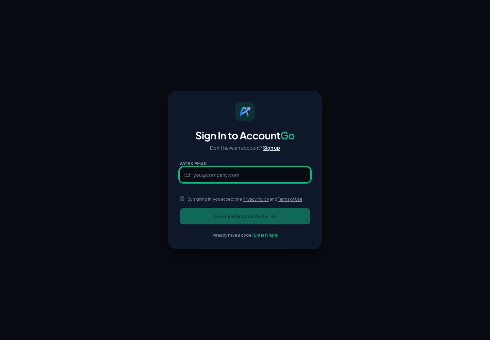
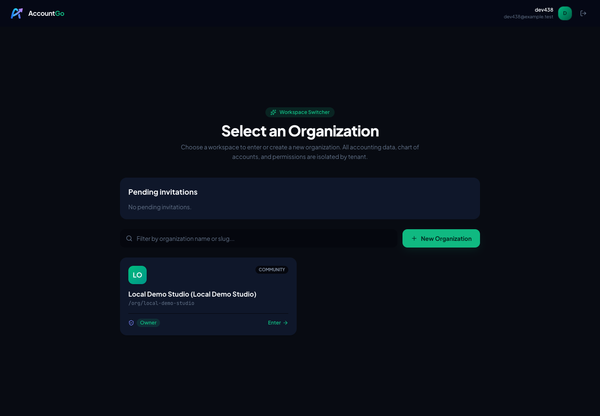
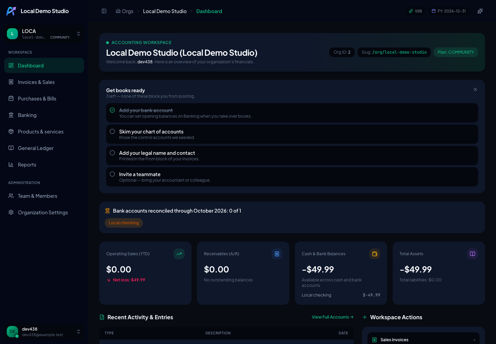
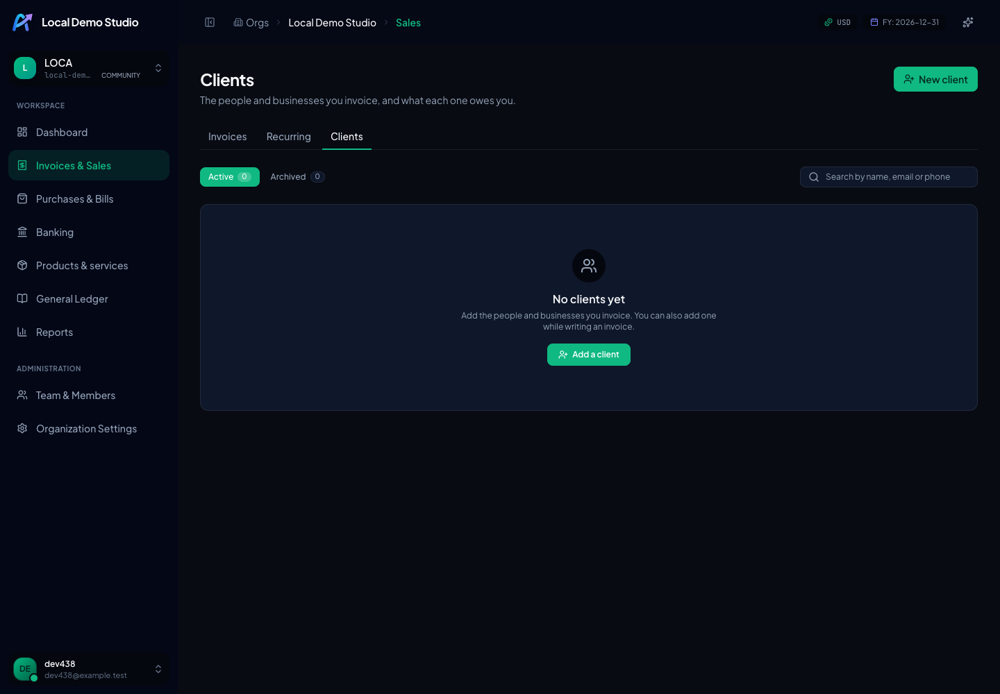
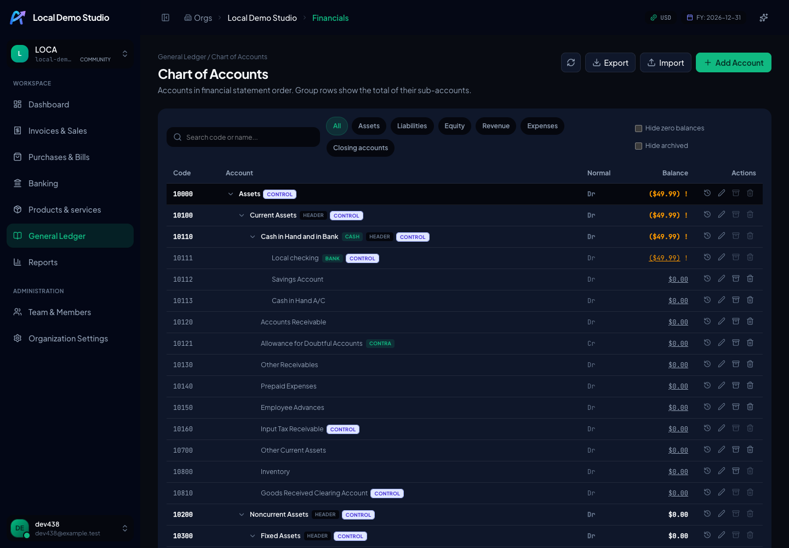
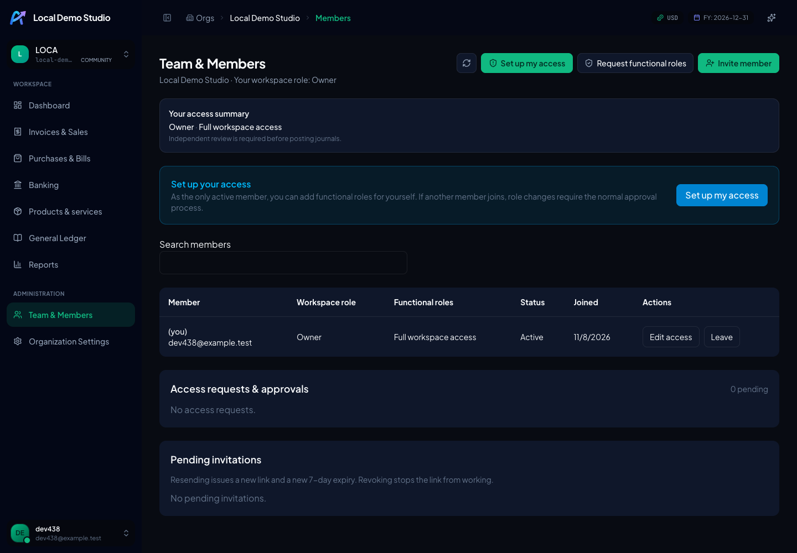
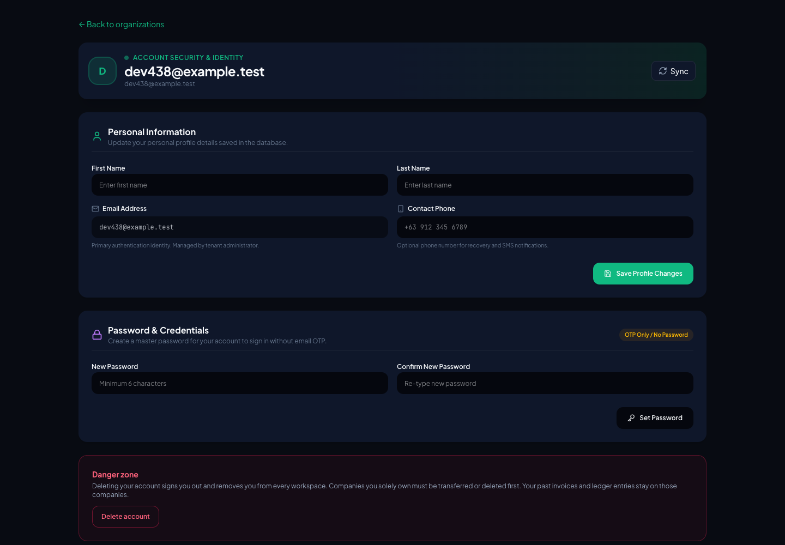
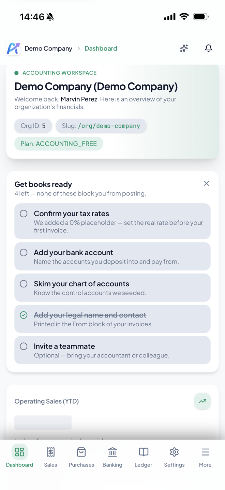
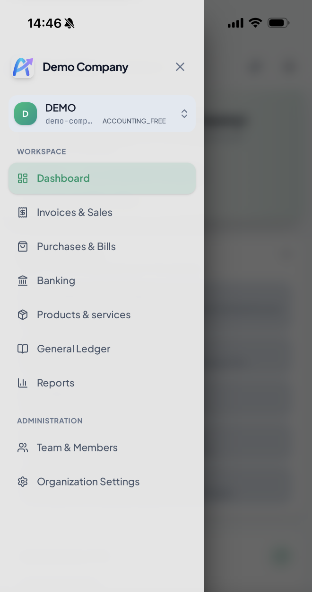
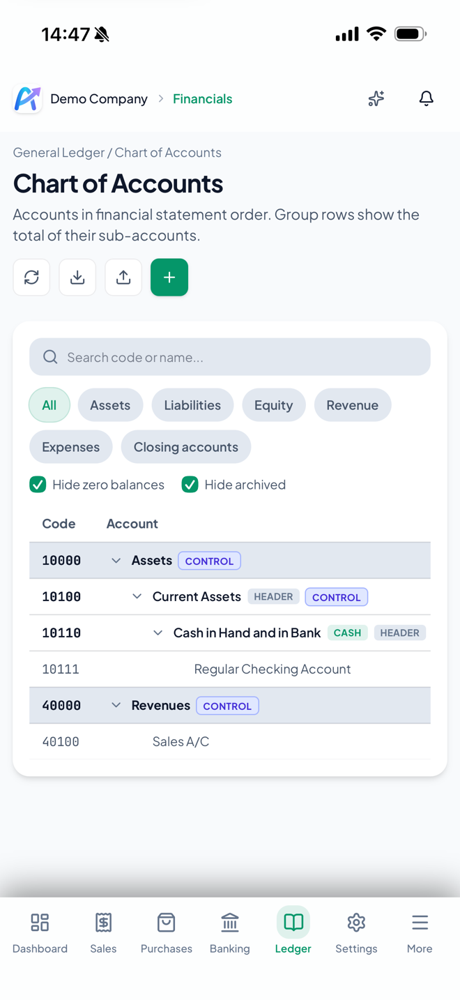

# User Interface Showcase

## 1. Passwordless Authentication & Magic Codes
Fast, secure sign-in with 6-digit OTP verification codes, sliding-window rate limiters, and HTTP-only session cookies.

---

## 2. Multi-Tenant Workspace Selector
Seamlessly switch between multiple companies, organizations, and branches with isolated data, custom currencies, and independent permission sets.

---

## 3. Executive Financial Dashboard
Real-time financial metrics, revenue vs. expense breakdowns, cash position, and quick navigation across accounting modules.

---

## 4. Sales & Customer Management
Manage customer directories, track accounts receivable, issue quotations, and process sales invoices with automatic tax and GL postings.

---

## 5. Financials & Chart of Accounts
Complete double-entry accounting ledger with hierarchical chart of accounts, customizable account classes, and real-time balance calculations.

---

## 6. Team & Organization Members (RBAC)
Role-based member management with support for `SystemAdministrators` and `GeneralUsers`, granular permissions, and tenant security.

---

## 7. Profile, Sessions & Security Hub
User profile management, credential administration, active device/session monitoring with single-click remote session revocation.

---

## 8. Mobile & Installable App (PWA)
Add AccountGo to your phone's home screen and it runs full-screen like a native app, with a bottom tab bar, a slide-out menu, and layouts that respect the iPhone notch and home indicator.

  
  &nbsp;
  
  &nbsp;
  

