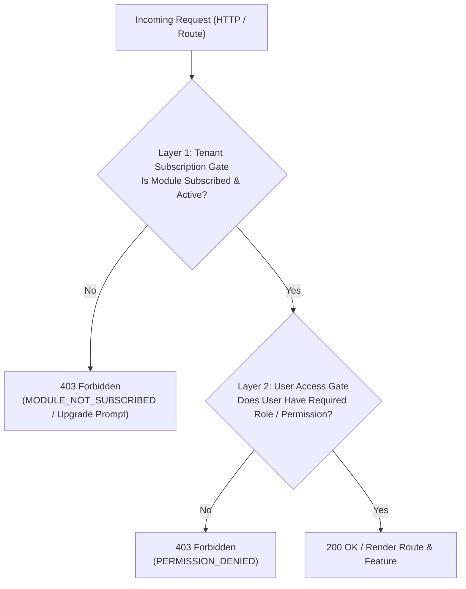
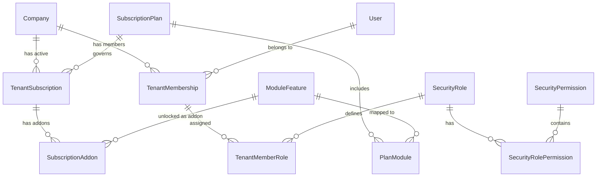

# AccountGo: Roles, Permissions & Central Subscription Architecture

## Executive Summary

AccountGo employs a two-plane authorization architecture that decouples **Tenant Capabilities** (what the organization is subscribed to) from **User Privileges** (what an individual member is permitted to do within those subscribed boundaries).



$$\mathbf{Effective\ Access} = \mathbf{IsSubscribed}(\text{Tenant}, \text{Module}) \;\land\; \mathbf{HasPermission}(\text{User}, \text{Tenant}, \text{Permission})$$

---

## 1. Subscription Tiers & Modular Architecture

### 1.1 Subscription Plans (`SubscriptionPlan`)

AccountGo provides three standard subscription tiers and flexible modular add-ons:

| Tier | Code | Included Modules | Target Audience | Key Capabilities |
| :--- | :--- | :--- | :--- | :--- |
| **Invoicing** | `invoicing` | `sales` | Freelancers, Solopreneurs, Contractors | Customers, Quotations, Sales Orders, Invoices, Receipts, and Sales Dashboard. Clean, distraction-free invoicing without double-entry complexity. |
| **Accounting** | `accounting` | `sales`, `financials`, `purchases`, `reports` | Small to Medium Growing Businesses | Full General Ledger, Chart of Accounts, Cash & Bank, Journal Entries, Vendors, Bills, and Financial Statements (P&L, Balance Sheet, Trial Balance). |
| **Enterprise** | `enterprise` | All modules (`sales`, `financials`, `purchases`, `inventory`, `reports`, `donations`, `audit`) | Established Organizations & Multi-Entity | Inventory stock control, non-profit donation tracking, audit logs, custom roles, and whitelabeling. |
| **Modular Add-Ons** | *custom* | Any individual module | Any subscriber | Invoicing plan subscribers can selectively add individual modules (e.g. Invoicing + `inventory` or Invoicing + `donations`). |

---

### 1.2 Module Catalog (`ModuleFeature`)

| Module Key | Display Name | Core Boundaries | Included in Invoicing | Included in Accounting | Included in Enterprise |
| :--- | :--- | :--- | :---: | :---: | :---: |
| `sales` | Invoicing & Sales | Customers, Quotations, Sales Orders, Sales Invoices, Receipts | ✅ Yes | ✅ Yes | ✅ Yes |
| `financials` | General Ledger & Banking | Chart of Accounts, Cash & Bank, Journal Entries, Balance Sheet | ❌ Add-on | ✅ Yes | ✅ Yes |
| `purchases` | Purchases & Bills | Vendors, Purchase Orders, Bills / Vendor Invoices, Payments | ❌ Add-on | ✅ Yes | ✅ Yes |
| `inventory` | Inventory & Items | Products & Services, Stock Items, Inventory Adjustments (ICJ) | ❌ Add-on | ❌ Add-on | ✅ Yes |
| `reports` | Financial Reports | Aging Reports, Tax Reports, P&L Comparison, Financial Statements | ❌ Add-on | ✅ Yes | ✅ Yes |
| `donations` | Donations & Non-Profit | Donors, Pledges, Tax Receipts, Donation Invoices | ❌ Add-on | ❌ Add-on | ✅ Yes |
| `audit` | Compliance & Auditing | Comprehensive Audit Trails, Field-Level Tracking, Log Retention | ❌ Add-on | ❌ Add-on | ✅ Yes |

---

### 1.3 Entity-Relationship Diagram



---

## 2. Roles & Permissions (RBAC & PBAC)

### 2.1 Permission Format

Permissions follow the standard hierarchy: `<module>.<resource>.<action>`.

```
<module>.<resource>.<action>
  ├── sales.customers.view
  ├── sales.customers.manage
  ├── sales.invoices.view
  ├── sales.invoices.create
  ├── sales.invoices.post
  ├── financials.accounts.view
  ├── financials.accounts.manage
  ├── financials.journal.create
  ├── financials.journal.post
  ├── purchases.vendors.view
  ├── purchases.bills.create
  ├── purchases.bills.post
  ├── inventory.items.manage
  ├── inventory.adjustments.post
  ├── admin.members.manage
  ├── admin.roles.manage
  └── admin.subscription.manage
```

### 2.2 Standard Role Matrix

| Permission | Owner / SuperAdmin | Administrator | Accountant | Sales Rep | Purchasing Agent | Viewer |
| :--- | :---: | :---: | :---: | :---: | :---: | :---: |
| `sales.invoices.view` | ✅ | ✅ | ✅ | ✅ | ❌ | ✅ |
| `sales.invoices.create` | ✅ | ✅ | ✅ | ✅ | ❌ | ❌ |
| `sales.invoices.post` | ✅ | ✅ | ✅ | ❌ | ❌ | ❌ |
| `financials.journal.post` | ✅ | ✅ | ✅ | ❌ | ❌ | ❌ |
| `purchases.bills.post` | ✅ | ✅ | ✅ | ❌ | ✅ | ❌ |
| `inventory.items.manage` | ✅ | ✅ | ✅ | ❌ | ❌ | ❌ |
| `admin.members.manage` | ✅ | ✅ | ❌ | ❌ | ❌ | ❌ |
| `admin.subscription.manage`| ✅ | ❌ | ❌ | ❌ | ❌ | ❌ |

---

## 3. Backend Architecture (.NET 9 Web API)

### 3.1 Subscription Gating Filter (`[RequireModule]`)

When a tenant requests an endpoint associated with a module they have not subscribed to, the request short-circuits with a `403 Forbidden` and a structured `ProblemDetails` payload:

```csharp
[AttributeUsage(AttributeTargets.Class | AttributeTargets.Method)]
public class RequireModuleAttribute : Attribute, IAsyncActionFilter
{
    private readonly string _moduleKey;
    public RequireModuleAttribute(string moduleKey) => _moduleKey = moduleKey;

    public async Task OnActionExecutionAsync(ActionExecutingContext context, ActionExecutionDelegate next)
    {
        var tenantContext = context.HttpContext.RequestServices.GetRequiredService<ITenantContext>();
        if (!tenantContext.IsModuleEnabled(_moduleKey))
        {
            context.Result = new ObjectResult(new ProblemDetails
            {
                Type = "https://accountgo.ph/errors/module-not-subscribed",
                Title = "Feature Module Not Subscribed",
                Detail = $"The '{_moduleKey}' module is not included in your organization's current plan.",
                Status = StatusCodes.Status403Forbidden,
                Extensions = 
                { 
                    ["code"] = "MODULE_NOT_SUBSCRIBED",
                    ["requiredModule"] = _moduleKey, 
                    ["upgradeAvailable"] = true 
                }
            })
            { StatusCode = StatusCodes.Status403Forbidden };
            return;
        }
        await next();
    }
}
```

### 3.2 Fine-Grained Permission Authorization Handler

Permissions are evaluated per tenant context, cached in-memory with tenant-specific cache keys for high performance:

```csharp
[AttributeUsage(AttributeTargets.Class | AttributeTargets.Method, AllowMultiple = true)]
public class RequirePermissionAttribute : AuthorizeAttribute
{
    public RequirePermissionAttribute(string permission) : base(policy: $"perm:{permission}") { }
}

public class PermissionAuthorizationHandler : AuthorizationHandler<PermissionRequirement>
{
    private readonly ISecurityService _securityService;
    private readonly ITenantContext _tenantContext;

    public PermissionAuthorizationHandler(ISecurityService securityService, ITenantContext tenantContext)
    {
        _securityService = securityService;
        _tenantContext = tenantContext;
    }

    protected override async Task HandleRequirementAsync(
        AuthorizationHandlerContext context, 
        PermissionRequirement requirement)
    {
        var username = context.User.Identity?.Name;
        var tenantId = _tenantContext.CurrentTenantId;
        
        // Fast-path: Global SystemAdministrators or Tenant Owners
        if (context.User.IsInRole("SystemAdministrators") || context.User.IsInRole("Owner"))
        {
            context.Succeed(requirement);
            return;
        }

        if (await _securityService.HasPermissionAsync(username, tenantId, requirement.Permission))
        {
            context.Succeed(requirement);
        }
    }
}
```

### 3.3 Controller Example

```csharp
[ApiController]
[Route("api/[controller]")]
[Authorize]
[RequireModule(Modules.Sales)] // Gated by Tenant Subscription
public class SalesController : BaseController
{
    [HttpGet("SalesInvoices")]
    [RequirePermission(Permissions.Sales.InvoiceView)] // Gated by User Permission
    public IActionResult GetSalesInvoices() => Ok(_salesService.GetSalesInvoices());

    [HttpPost("PostSalesInvoice")]
    [RequirePermission(Permissions.Sales.InvoicePost)]
    public IActionResult PostSalesInvoice([FromBody] PostInvoiceDto dto) => Ok(_salesService.PostSalesInvoice(dto));
}
```

---

## 4. Frontend Architecture (React 19 + TypeScript + Vite)

### 4.1 Type System & Context State

```typescript
export type ModuleKey = 
  | 'sales' 
  | 'financials' 
  | 'purchases' 
  | 'inventory' 
  | 'reports' 
  | 'donations' 
  | 'audit';

export type PlanKey = 'invoicing' | 'accounting' | 'enterprise';

export interface SubscriptionInfo {
  planId: PlanKey;
  planName: string;
  status: 'active' | 'trialing' | 'past_due' | 'canceled';
  activeModules: ModuleKey[];
  validUntil: string;
}

export interface TenantContextType {
  currentOrg: OrgDetails;
  availableOrgs: OrgDetails[];
  subscription: SubscriptionInfo;
  userPermissions: string[];
  hasModule: (module: ModuleKey) => boolean;
  hasPermission: (permission: string | string[]) => boolean;
  canAccess: (module: ModuleKey, permission?: string) => boolean;
}
```

### 4.2 Dynamic Sidebar Navigation

In `src/Web/src/components/Sidebar.tsx`, each navigation item binds to its required module and optional permission:

```typescript
interface NavItemConfig {
  name: string;
  path: string;
  icon: React.ComponentType;
  module: ModuleKey;
  permission?: string;
  badge?: string;
}

const ALL_NAV_ITEMS: NavItemConfig[] = [
  { name: 'Dashboard', path: '/dashboard', icon: LayoutDashboard, module: 'sales' },
  { name: 'Invoicing & Sales', path: '/sales', icon: Receipt, module: 'sales', permission: 'sales.invoices.view' },
  { name: 'Financials', path: '/financials', icon: BookOpen, module: 'financials', permission: 'financials.accounts.view', badge: 'Ledger' },
  { name: 'Purchases & Bills', path: '/purchases', icon: ShoppingBag, module: 'purchases', permission: 'purchases.bills.view' },
  { name: 'Reports', path: '/reports', icon: BarChart3, module: 'reports', permission: 'reports.view' },
];

// Computed navigation list:
const visibleLinks = ALL_NAV_ITEMS.filter(item => {
  if (!hasModule(item.module)) return false;
  if (item.permission && !hasPermission(item.permission)) return false;
  return true;
});
```

### 4.3 Declarative UI Gating Components

```tsx
// 1. Module Gating
<RequiresModule module="financials" fallback={<UpgradeToAccountingPrompt />}>
  <ChartOfAccountsTable />
</RequiresModule>

// 2. Permission Gating
<HasPermission permission="sales.invoices.post">
  <Button onClick={handlePostInvoice}>Post Invoice</Button>
</HasPermission>

// 3. Combined Gating
<Gate module="sales" permission="sales.invoices.create">
  <CreateInvoiceButton />
</Gate>
```

---

## 5. Central Subscription Management UI

Located under `Organization Settings -> Subscription & Billing`:
1. **Active Plan Badge & Health**: Shows active plan (`Invoicing`, `Accounting`, or `Enterprise`), status, and billing cycle.
2. **Module Directory**: Visual toggles displaying which modules are active, which are included in the plan, and one-click add-on activation.
3. **Seamless Upgrade Path**: Invoicing users can preview and upgrade to `Accounting` with zero data migration or friction.

---

## 6. Implementation Roadmap

- [ ] **Step 1: Frontend Types & State**: Extend `TenantContext` to support `subscription` and `userPermissions`, with default fallback to `invoicing` or current plan.
- [ ] **Step 2: Dynamic Navigation in Sidebar**: Update `Sidebar.tsx` to automatically filter items by active modules and user permissions.
- [ ] **Step 3: Declarative React Gating Components**: Create `<Gate>`, `<RequiresModule>`, and `<HasPermission>`.
- [ ] **Step 4: Backend Action Filters**: Implement `RequireModuleAttribute` in `src/Api/Controllers/BaseController.cs` or filter pipeline.
- [ ] **Step 5: Subscription & Roles Settings View**: Build the management interface inside Organization Settings.
